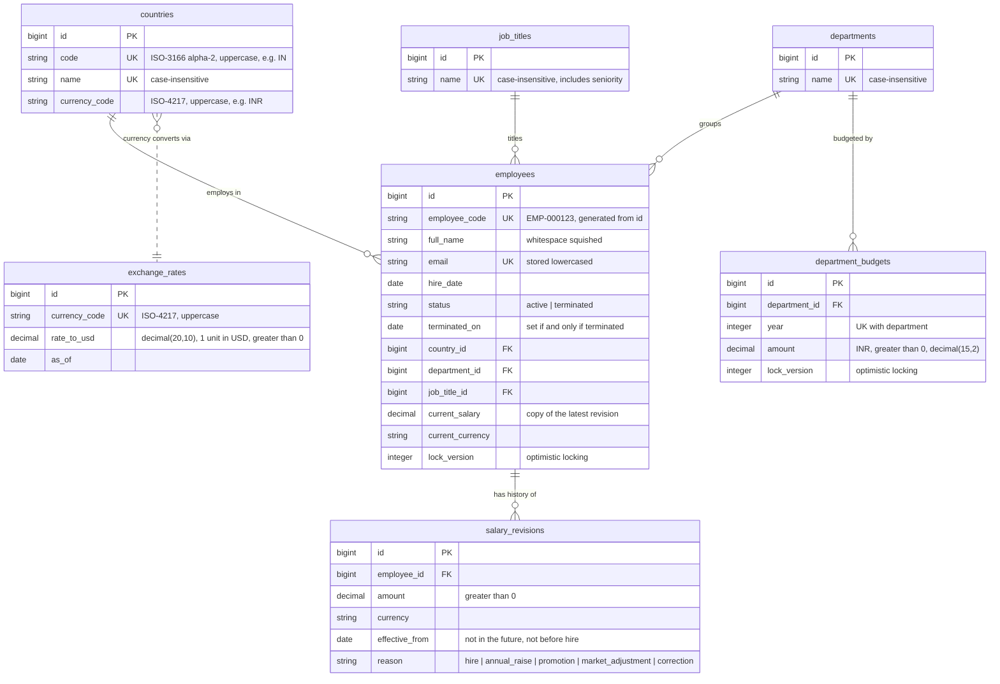
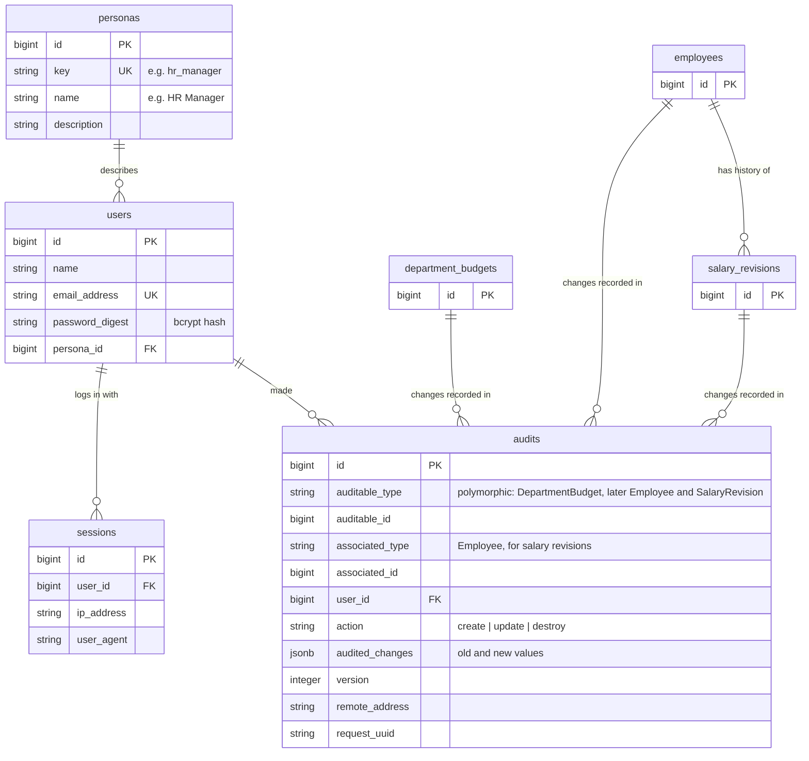

# Database schema

The planned and current shape of Horizon's PostgreSQL database. Keep it in sync: **update this file in the same commit as any migration that changes the schema.**

This file is the readable overview. The exact definition lives in [backend/db/schema.rb](../backend/db/schema.rb), which Rails regenerates on every migration.

Status key: ✅ built · 🛠 this phase (domain model) · ⏳ later phase

## Diagram

`department_budgets` ✅ (ADR 0020): one yearly budget per department, always in INR (the reporting currency), so it has no currency column.

All tables also have `created_at` and `updated_at`.

### Login ✅ and audit trail ✅ (budgets) ⏳ (employees, salaries)

Login tables (personas, users, sessions) are built. The `audits` table is built and department budgets use it (ADR 0020). Employees and salary revisions join it in the audit-trail add-on. Users link to the domain only through `audits`, which records which user changed which record.

`audits` comes from the `audited` gem's generator (ADR 0012). It has no `updated_at`, because audit rows are never changed. The link from `audits` to the record it describes is polymorphic (a type column plus an ID column), so it can't be a real foreign key.

## Tables

| Table | Status | Purpose | Decided in |
|---|---|---|---|
| `countries` | ✅ | Lookup list of countries and their currency | ADR 0003 |
| `exchange_rates` | ✅ | Fixed, dated rates for the org-wide USD view | ADR 0007 |
| `departments` | ✅ | Lookup list of departments | ADR 0003 |
| `job_titles` | ✅ | Lookup list of titles, including seniority | ADR 0003 |
| `employees` | ✅ | One row per person, with a copy of their current salary | ADR 0003, 0004, 0008, 0014 |
| `salary_revisions` | ✅ | Every salary change, with its reason (append-only) | ADR 0004, 0005, 0006 |
| `personas` | ✅ | The kind of user, e.g. HR Manager | ADR 0010 |
| `users` | ✅ | People who log in, each with a persona | ADR 0009, 0010 |
| `sessions` | ✅ | One row per login | ADR 0009 |
| `department_budgets` | ✅ | Each department's yearly budget, in INR | ADR 0020 |
| `audits` | ✅ budgets, ⏳ employees and salaries | Who changed what, and when (`audited` gem) | ADR 0012, 0020 |

## Rules the database enforces

Model validations give friendly error messages. The database rules below are the safety net for anything that skips the model, such as bulk inserts in the seed script.

- **Money:** `decimal(15,2)`, never float (ADR 0006). `salary_revisions.amount > 0`.
- **Exchange rates:** `decimal(20,10)`, so very small rates stay exact (e.g. IDR to USD is about 0.0000612). `rate_to_usd > 0`.
- **Foreign keys** on every `*_id` column. No cascading deletes: employees are terminated, never deleted (ADR 0008).

Some rules can't be check constraints, so the models enforce them:
- **Rules that depend on today's date:** a salary revision's `effective_from` can't be in the future. Postgres expects check constraints to give the same answer forever, and `CURRENT_DATE` doesn't.
- **Rules that compare against another table:** `effective_from` can't be before the employee's `hire_date`, and a currency must match the country's. A check constraint only sees its own row.
- **Append-only history:** a saved salary revision can't be edited or deleted. Mistakes are fixed with a new `correction` row. An employee with salary history can't be deleted either.
- **Unique:** `countries.code`, `exchange_rates.currency_code`, `employees.employee_code`, `employees.email`, `department_budgets (department_id, year)`.
- **Budgets:** `amount > 0`, and `year` between 2000 and 2100. Only this year's budget can be set or changed, which depends on today's date, so the model enforces it.
- **Unique, ignoring case:** `countries.name`, `departments.name` and `job_titles.name` use a unique index on `LOWER(name)`. "Engineering" and "engineering" can't both exist, but the display keeps HR's capitalisation. A plain unique index would let the spreadsheet's spelling problem back in through the lookup tables.
- **Formats:** `countries.code` is two uppercase letters, and currency codes are three (check constraints, e.g. `code ~ '^[A-Z]{2}$'`).
- **Status:** `status IN ('active', 'terminated')`. `terminated_on` is set if and only if the status is `terminated`, and is never before `hire_date`.
- **Reason:** `reason IN ('hire', 'annual_raise', 'promotion', 'market_adjustment', 'correction')`.
- **NOT NULL** on every column except `employees.terminated_on`.

## Cleaning values before saving (models)

The models tidy input before it's validated, so the rules above see clean values. This uses Rails `normalizes`.

| Column | Normalised to |
|---|---|
| `countries.name`, `departments.name`, `job_titles.name`, `employees.full_name` | Whitespace squished: trimmed, inner runs collapsed to one space |
| `countries.code`, `countries.currency_code`, `exchange_rates.currency_code`, `*.currency` | Trimmed and uppercased: `" in "` becomes `"IN"` |
| `employees.email` | Trimmed and lowercased |

Models also validate uniqueness with `case_sensitive: false`, so HR gets a friendly "has already been taken" message instead of a database error.

## Indexes beyond the unique ones

| Index | Serves |
|---|---|
| `employees (country_id, job_title_id)` | Insights: pay per country, and per title within a country |
| `employees (department_id)` | Directory filter and payroll per department |
| `employees (status)` | Active-only lists and insights |
| `salary_revisions (employee_id, effective_from)` | An employee's salary history, newest first |

Deliberately left out: a trigram index for name search. At 10,000 rows a plain scan takes milliseconds. We'll add one only if query plans in the performance phase show it's needed.
